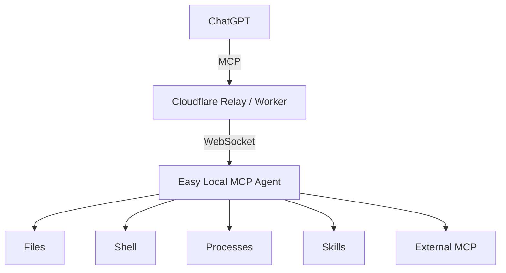

<p align="center">
  
</p>

<h1 align="center">Easy Local MCP</h1>

<p align="center">
  An MCP bridge for operator-managed hosts that lets ChatGPT work with files, shell, processes, skills, workspaces, and external MCP servers.
</p>

<p align="center">
  <a href="README.zh-CN.md">Chinese README</a> | <a href="CONTRIBUTING.md">Contributing</a>
</p>

## What is Easy Local MCP?

Easy Local MCP connects ChatGPT to capabilities on your own computer through the Model Context Protocol (MCP).



The Agent makes the outbound connection, so you do not need a public IP address or an inbound port.

## Security Philosophy

**Trust the prepared environment, not the agent.**

Easy Local MCP assumes agents operate in dedicated, operator-prepared environments, preferably isolated VMs, where mistakes and destructive actions are acceptable risks.

Operators are responsible for isolation, backups, and protecting sensitive data. This project focuses on connecting and managing remote hosts, including those behind NAT, and granting agents access through operator approval.

It is **not a fine-grained command authorization system or a security sandbox**.

For different approaches involving more granular tool controls and permissions, consider [Bridge MCP](https://github.com/muchiny/bridge-mcp), [Desktop Commander MCP](https://github.com/wonderwhy-er/DesktopCommanderMCP), and [Conduit Desktop](https://github.com/advenimus/conduit-desktop). Their security models and guarantees differ.

## Project Origin

This project is an independent fork of [Ryanma-YX/easy-local-mcp](https://github.com/Ryanma-YX/easy-local-mcp), which itself builds upon [daodao97/localmcp](https://github.com/daodao97/localmcp). Thanks to both projects and their contributors for their foundational work.

We maintain our own design philosophy, threat model, and contribution policies. These policies do not necessarily reflect upstream.

We may contribute compatible improvements upstream when appropriate, while respecting upstream's own development and review standards. Changes that diverge from upstream's direction may remain exclusive to this fork.

For the foreseeable future, however, upstream contributions are unlikely. We understand upstream to expect substantial human code review, which our current development workflow cannot accommodate. We welcome revisiting this if upstream clarifies or changes its policy to explicitly accept AI-reviewed contributions.

## Highlights

- Windows desktop app with Control Center, system tray, optional start-with-system, and automatic reconnect for registered devices
- Files: browse, search, read, create, edit, move, and delete
- Shell commands and persistent processes
- Multiple workspaces
- Skills
- External MCP servers through a stable gateway
- LOCKED by default; configured read-only tools can remain available
- Local LOCK / UNLOCK gate for privileged operations
- Authenticated local IPC
- Audit logging and credential rotation
- Public Relay for quick setup, with self-hosted options for long-term or sensitive use
- Bundled Node runtime in the Windows installer

## Install

### Windows

Download the latest Windows x64 installer from [GitHub Releases](https://github.com/Ryanma-YX/easy-local-mcp/releases/latest).

The desktop installer includes the required runtime. The target PC does not need Node.js or Rust.

### Build from source

Requirements:

- Node.js 22+
- Rust stable for the desktop app
- Visual Studio 2022 / MSVC and Windows SDK for the Windows installer

```powershell
git clone https://github.com/Ryanma-YX/easy-local-mcp.git
cd easy-local-mcp
npm ci
npm run desktop:bundle
```

## Quick start

1. Start **Easy Local MCP**.
2. Choose the public Relay for a quick start, or enter the URL of a Relay you control.
3. Click **Save & Start Agent**.
4. In Control Center, use **Reveal / Copy MCP URL**.
5. Enable ChatGPT Developer Mode: [Open Developer Mode settings](https://chatgpt.com/#settings/Security?section=developer-mode).
6. Create a connector: [Open Create Connector](https://chatgpt.com/plugins#settings/Connectors?create-connector=true&redirectAfter=%2Fplugins).
7. Paste the complete MCP URL and set **Authentication** to **None**.
8. Start a new chat and use the connector.

> ChatGPT may hide the Create Connector entry in the normal UI. The direct link above opens the connector creation page.

The complete MCP URL contains an access credential. Do not post it in issues, screenshots, logs, chats, or Git repositories.

## Access Controls

LOCK/UNLOCK controls when privileged capabilities can run; it does not isolate the Agent or make an unsafe host safe.

The Agent starts **LOCKED**.

Configured privileged tools remain visible in the MCP tool list while locked so ChatGPT can discover and refresh connector capabilities correctly. Visibility does **not** grant execution permission.

While LOCKED:

- read-only capabilities remain available when enabled
- configured privileged capabilities remain discoverable
- file writes, deletes, shell commands, processes, and external MCP execution are denied

Privileged operations become callable only after a local Unlock and are blocked again when the Unlock expires or the Agent is locked.

For the full security model, see [SECURITY.md](SECURITY.md) and the [Security Model wiki page](https://github.com/Ryanma-YX/easy-local-mcp/wiki/Security-Model).

## Common commands

```powershell
easy-local-mcp ui
easy-local-mcp status
easy-local-mcp url
easy-local-mcp unlock
easy-local-mcp lock
easy-local-mcp reload
easy-local-mcp rotate
easy-local-mcp join <zone-code>
easy-local-mcp stop
```

The legacy `localmcp` command remains available for compatibility.

## Self-host the Relay

The prefilled public Relay is currently provided as an upstream/community shared service and is convenient for quick evaluation. Because it is operated outside this fork, this project cannot guarantee its availability, capacity, or long-term continuity.

For regular use, company source code, ERP/MES data, internal files, credentials, or production environments, a Relay under your own control is recommended. You can host it on a machine you manage (with a reachable HTTPS endpoint), on your own VPS, or on your own Cloudflare Worker.

[](https://deploy.workers.cloudflare.com/?url=https://github.com/Ryanma-YX/easy-local-mcp)

After deployment, copy the Relay or Worker URL and configure it in Easy Local MCP.

See [Self-hosted Relay](https://github.com/Ryanma-YX/easy-local-mcp/wiki/Self-hosted-Relay) for deployment and registration-protection details.

## Multi-Device Zones

A Relay can group several devices into a Zone. The `/admin` dashboard is protected by a dedicated `RELAY_ADMIN_TOKEN_HASH`; without that configuration it fails closed and exposes no management actions. After Relay Admin login, you can create/import Zones, generate one-time join codes, view device status, rotate the shared connector, rename devices, or revoke them. On a stopped device, stage the join with `localmcp join <zone-code>`, then start Easy Local MCP normally.

A Zone also exposes one shared MCP connector URL. ChatGPT can connect to that URL once, call `list_devices`, and route the normal LocalMCP tools by adding a required `device` argument. Per-device MCP URLs continue to work for compatibility, and the target Agent still enforces its own local LOCK and feature permissions. Existing Zones created by an earlier Zone build can enable the shared connector by choosing **Rotate Connector** in `/admin`. See [Multi-Device Zones](https://github.com/Ryanma-YX/easy-local-mcp/wiki/Multi-Device-Zones).

## Development

```powershell
npm ci
npm run check
npm test
npm run build
```

Desktop-related commands:

```powershell
npm run tray:check
npm run tray:build
npm run desktop:bundle
```

More documentation is available in the [project Wiki](https://github.com/Ryanma-YX/easy-local-mcp/wiki).

## Contributing

AI-assisted and autonomous contributions are welcome. Please read [CONTRIBUTING.md](CONTRIBUTING.md) before opening a PR for our quality, review, and project-alignment expectations.

## License

MIT. See [LICENSE](LICENSE).
